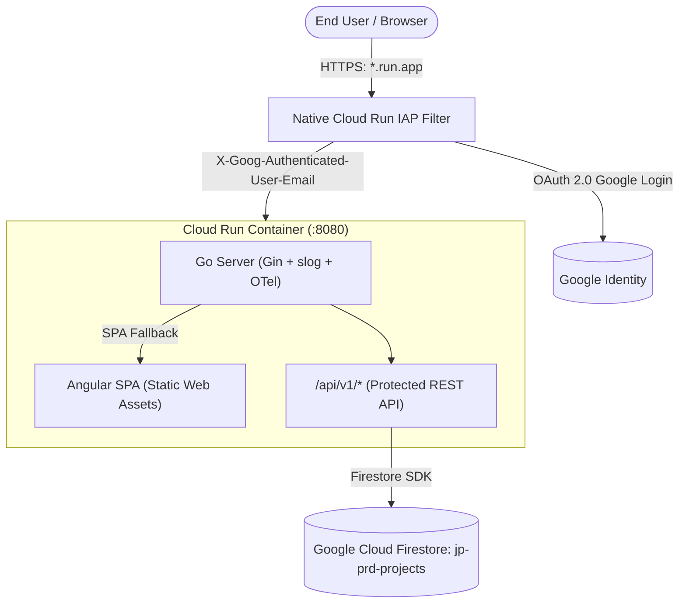
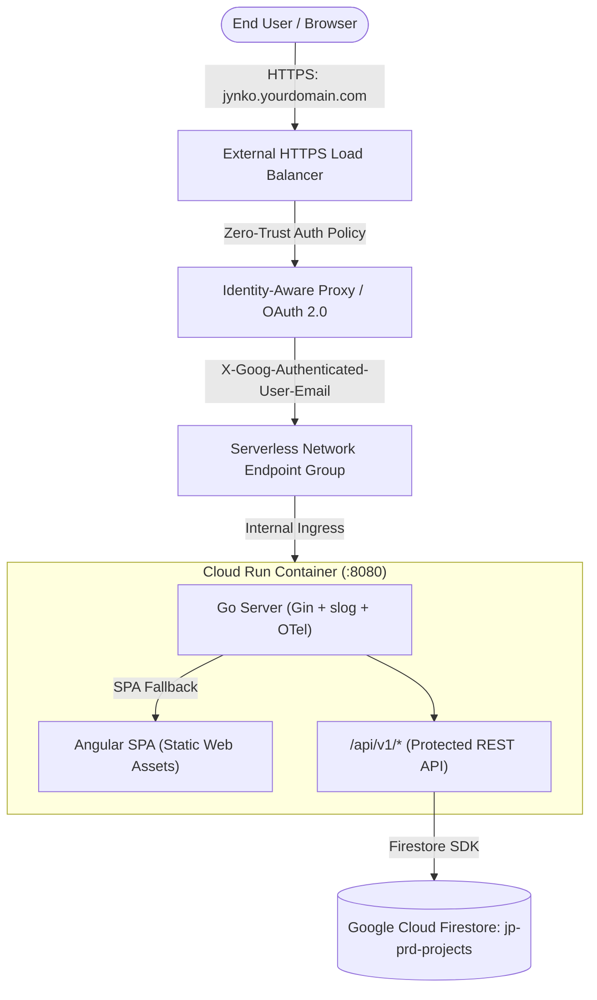

# Google Cloud Platform (GCP) Deployment & IAP Guide

This document is the official, complete step-by-step guide to deploying **Jynko** to Google Cloud Platform using **Google Cloud Run**, **Google Cloud Firestore**, **Cloud Build**, and **Google Cloud Identity-Aware Proxy (IAP)**.

---

## 1. Architectural Patterns

Jynko uses a unified production container packaging both the compiled Go REST API server and the Angular 18 Single Page Application (SPA), completely eliminating CORS issues and ensuring atomic deployments.

Depending on your requirements and infrastructure budget, you can deploy and secure Jynko using either of two supported architecture patterns:

### Pattern A: Direct Cloud Run with Native IAP (No Load Balancer, Zero Custom Domain Needed)
*Recommended for quick deployments, internal tools, dev/staging environments, or cost-conscious production setups.*
- **Zero Load Balancer Cost**: Saves ~$18–$30/month in baseline Google Cloud Load Balancer infrastructure costs.
- **Default Cloud Run URL**: Works immediately with your default `https://<service>-<hash>-<region>.a.run.app` address.
- **Native Google Security**: Identity-Aware Proxy (IAP) directly authenticates incoming user sessions, blocks unauthenticated callers, and forwards verified identity headers (`X-Goog-Authenticated-User-Email`, `X-Goog-Authenticated-User-Id`) to Jynko.



### Pattern B: Enterprise HTTPS Load Balancer with Custom Domain & IAP
*Recommended for organizations requiring corporate custom domains (e.g. `jynko.yourcompany.com`) and centralized multi-region routing.*
- **Custom Domain & SSL**: Uses Google-managed SSL certificates and global external Anycast IP routing.
- **Serverless NEG**: Routes traffic from the Load Balancer backend service to Cloud Run.
- **IAP on Backend Service**: Intercepts requests at the load balancer level before forwarding to Cloud Run.



---

## 2. Prerequisites & Initial GCP Setup

### 2.1 Install & Initialize Google Cloud SDK
Ensure you have the Google Cloud CLI installed and logged in:
```bash
gcloud auth login
gcloud config set project YOUR_PROJECT_ID
```

Set common environment variables for your deployment shell:
```bash
export PROJECT_ID=$(gcloud config get-value project)
export PROJECT_NUM=$(gcloud projects describe $PROJECT_ID --format='value(projectNumber)')
export REGION="europe-west3"
export SERVICE_NAME="jynko-plan-app"
export AR_REPO="jynko-plan"
export RUNNER_SA="jynko-plan-runner"
export BUILDER_SA="jynko-plan-build"
export DOMAIN="jynko.yourdomain.com"
```

### 2.2 Enable Required Google Cloud APIs
```bash
gcloud services enable \
  run.googleapis.com \
  cloudbuild.googleapis.com \
  artifactregistry.googleapis.com \
  firestore.googleapis.com \
  iap.googleapis.com \
  compute.googleapis.com \
  sourcerepo.googleapis.com
```

### 2.3 Create Cloud Firestore Database (Native Mode)
If your project does not already have a Cloud Firestore database:
```bash
gcloud firestore databases create --location=eur3 --type=firestore-native
```
> [!NOTE]
> Jynko supports multiple environments sharing the same database via automated collection prefixing:
> - Production: `jp-prd-projects`
> - Staging: `jp-stg-projects`
> - Development: `jp-dev-projects`

### 2.4 Create Artifact Registry Repository
Create the Docker repository where Cloud Build will store container images:
```bash
gcloud artifacts repositories create $AR_REPO \
  --repository-format=docker \
  --location=$REGION \
  --description="Docker repository for Jynko releases"
```

---

## 3. Service Accounts & IAM Permissions

### 3.1 Runtime Service Account for Cloud Run
Create the least-privilege service account used by the running Jynko container:
```bash
# Create runtime service account
gcloud iam service-accounts create $RUNNER_SA \
  --description="Runtime service account for Jynko Cloud Run service" \
  --display-name="Jynko Plan Runner"

# Grant permission to read and write to Firestore
gcloud projects add-iam-policy-binding $PROJECT_ID \
  --member="serviceAccount:${RUNNER_SA}@${PROJECT_ID}.iam.gserviceaccount.com" \
  --role="roles/datastore.user"
```

### 3.2 Cloud Build Service Account Permissions
Create a dedicated build service account or configure permissions so Cloud Build can compile, push images, and deploy to Cloud Run:
```bash
# Create build service account
gcloud iam service-accounts create $BUILDER_SA \
  --description="Build service account for Jynko Cloud Build triggers" \
  --display-name="Jynko Plan Builder"

# Allow Cloud Build to deploy to Cloud Run
gcloud projects add-iam-policy-binding $PROJECT_ID \
  --member="serviceAccount:${BUILDER_SA}@${PROJECT_ID}.iam.gserviceaccount.com" \
  --role="roles/run.admin"

# Allow Cloud Build to write build logs
gcloud projects add-iam-policy-binding $PROJECT_ID \
  --member="serviceAccount:${BUILDER_SA}@${PROJECT_ID}.iam.gserviceaccount.com" \
  --role="roles/logging.logWriter"

# Allow Cloud Build to read Cloud Source Repositories
gcloud projects add-iam-policy-binding $PROJECT_ID \
  --member="serviceAccount:${BUILDER_SA}@${PROJECT_ID}.iam.gserviceaccount.com" \
  --role="roles/source.reader"

# Allow Cloud Build to push images to Artifact Registry
gcloud projects add-iam-policy-binding $PROJECT_ID \
  --member="serviceAccount:${BUILDER_SA}@${PROJECT_ID}.iam.gserviceaccount.com" \
  --role="roles/artifactregistry.writer"

# Allow Cloud Build to act as the runtime service account
gcloud iam service-accounts add-iam-policy-binding \
  "${RUNNER_SA}@${PROJECT_ID}.iam.gserviceaccount.com" \
  --member="serviceAccount:${BUILDER_SA}@${PROJECT_ID}.iam.gserviceaccount.com" \
  --role="roles/iam.serviceAccountUser"
```

---

## 4. Manual Deployment via Cloud Build CLI

To test the deployment manually from your local terminal:
```bash
gcloud builds submit --config=cloudbuild.yaml \
  --substitutions=_REGION=$REGION,_AR_LOCATION=$REGION,_AR_REPOSITORY=$AR_REPO,_SERVICE_NAME=$SERVICE_NAME,_SERVICE_ACCOUNT=$RUNNER_SA
```

---

## 5. Setting Up Continuous Deployment (Cloud Build Triggers)

Automate deployments whenever code is pushed to your repository. You can connect via **GitHub** or Google **Cloud Source Repositories**.

### Option A: Trigger from GitHub (Cloud Build 2nd Gen)
1. In the Google Cloud Console, navigate to **Cloud Build > Repositories (2nd gen)**.
2. Select your region (`europe-west3`) and click **Create Host Connection** > **GitHub**.
3. Authenticate with GitHub and link your repository (e.g. `gabihodoroaga/jynko-plan`).
4. Create the build trigger via `gcloud`:
   ```bash
   gcloud builds triggers create github \
     --name="jynko-plan-github-main" \
     --repo-name="jynko-plan" \
     --repo-owner="gabihodoroaga" \
     --branch-pattern="^main$" \
     --build-config="cloudbuild.yaml" \
     --region=$REGION \
     --service-account="projects/${PROJECT_ID}/serviceAccounts/${BUILDER_SA}@${PROJECT_ID}.iam.gserviceaccount.com" \
     --substitutions=_REGION=$REGION,_AR_LOCATION=$REGION,_AR_REPOSITORY=$AR_REPO,_SERVICE_NAME=$SERVICE_NAME,_SERVICE_ACCOUNT=$RUNNER_SA
   ```

### Option B: Trigger from Google Cloud Source Repositories (Alternate)
If you host your repository directly in Google Cloud Source Repositories or mirror an external repository into GCP:

1. **Create the Cloud Source Repository**:
   ```bash
   gcloud source repos create jynko-plan
   ```

2. **Push your code to Cloud Source Repositories**:
   ```bash
   # Add the Google Cloud Source Repository as a remote
   git remote add google https://source.developers.google.com/p/$PROJECT_ID/r/jynko-plan

   # Push code and branches
   git push --all google
   ```

3. **Create the Cloud Build Trigger for Cloud Source Repositories**:
   ```bash
   gcloud builds triggers create cloud-source-repositories \
     --name="jynko-plan-csr-main" \
     --repo="jynko-plan" \
     --branch-pattern="^main$" \
     --build-config="cloudbuild.yaml" \
     --region=$REGION \
     --service-account="projects/${PROJECT_ID}/serviceAccounts/${BUILDER_SA}@${PROJECT_ID}.iam.gserviceaccount.com" \
     --substitutions=_REGION=$REGION,_AR_LOCATION=$REGION,_AR_REPOSITORY=$AR_REPO,_SERVICE_NAME=$SERVICE_NAME,_SERVICE_ACCOUNT=$RUNNER_SA
   ```

*(In the Google Cloud Console, this can also be set under **Cloud Build > Triggers > Create Trigger**, selecting **Event: Push to a branch**, **Source: Cloud Source Repositories**, and **Configuration: Cloud Build configuration file (`cloudbuild.yaml`)**).*

---

## 6. Configuring Identity-Aware Proxy (IAP)

Choose either **Method 1 (Native Direct IAP on Cloud Run — No Load Balancer, No Custom Domain)** or **Method 2 (External Load Balancer with Custom Domain)**.

### Common Prerequisite: Configure OAuth Consent Screen & Client ID
1. In the Google Cloud Console, navigate to **APIs & Services > OAuth consent screen**.
2. Select **User Type**:
   - **Internal**: Recommended for Google Workspace organizations (all employees with `@company.com` can sign in without review).
   - **External**: For personal Gmail accounts (requires adding test users under *Audience*).
3. Fill in:
   - **App name**: `Jynko`
   - **User support email**: your email
   - **Developer contact information**: your email
4. Click **Save and Continue**.
5. Navigate to **APIs & Services > Credentials** > **Create Credentials > OAuth client ID**:
   - **Application type**: `Web application`
   - **Name**: `Jynko IAP Client`
   - Click **Create**.
6. Save the generated credentials:
   ```bash
   export CLIENT_ID="your-client-id.apps.googleusercontent.com"
   export CLIENT_SECRET="your-client-secret"
   ```

---

### Method 1: Native Direct IAP on Cloud Run (No Load Balancer, No Custom Domain)

Google Cloud Run natively supports direct Identity-Aware Proxy integration. This protects the service's default `https://<service>-<hash>.a.run.app` URL without requiring any Load Balancer, Serverless NEG, static IP, or custom domain!

#### Step 1.1: Enable Native IAP on Cloud Run
Run the following command to turn on direct IAP for your Cloud Run service:
```bash
gcloud run services update $SERVICE_NAME \
  --region=$REGION \
  --iap
```
*(Or in the Google Cloud Console: navigate to **Cloud Run** > select `$SERVICE_NAME` > **Security** tab > check **Identity-Aware Proxy (IAP)** > **Save**).*

#### Step 1.2: Grant IAP Service Agent Invoker Permission
Cloud Run requires the Google-managed IAP Service Agent to have permission to invoke the container:
```bash
gcloud run services add-iam-policy-binding $SERVICE_NAME \
  --region=$REGION \
  --member="serviceAccount:service-${PROJECT_NUM}@gcp-sa-iap.iam.gserviceaccount.com" \
  --role="roles/run.invoker"
```

#### Step 1.3: Grant End Users Access via IAP Role
Grant access to specific users, domains, or Google Workspace groups by assigning the `roles/iap.httpsResourceAccessor` role scoped to the `cloud-run` resource type:
```bash
# Grant access to a single user
gcloud beta iap web add-iam-policy-binding \
  --resource-type=cloud-run \
  --service=$SERVICE_NAME \
  --region=$REGION \
  --member="user:alice@yourcompany.com" \
  --role="roles/iap.httpsResourceAccessor"

# Or grant access to an entire Google Workspace group
gcloud beta iap web add-iam-policy-binding \
  --resource-type=cloud-run \
  --service=$SERVICE_NAME \
  --region=$REGION \
  --member="group:engineering@yourcompany.com" \
  --role="roles/iap.httpsResourceAccessor"
```

#### Step 1.4: Accessing the Application
1. Retrieve your Cloud Run service URL:
   ```bash
   gcloud run services describe $SERVICE_NAME --region=$REGION --format='value(status.url)'
   ```
2. Open the URL in your browser.
3. You will immediately see the official Google Sign-in screen enforced by IAP. Once signed in, Jynko extracts your identity and automatically grants you access!

---

### Method 2: External HTTP(S) Load Balancer + Serverless NEG + Custom Domain

If your team requires a custom corporate domain (e.g. `https://jynko.yourcompany.com`), use an External Application Load Balancer fronting a Serverless Network Endpoint Group (NEG).

#### Step 2.1: Create Serverless NEG and Backend Service
```bash
# 1. Create Serverless Network Endpoint Group (NEG) pointing to the Cloud Run service
gcloud compute network-endpoint-groups create jynko-neg \
  --region=$REGION \
  --network-endpoint-type=serverless \
  --cloud-run-service=$SERVICE_NAME

# 2. Create Global Backend Service with EXTERNAL_MANAGED scheme
gcloud compute backend-services create jynko-backend-service \
  --global \
  --load-balancing-scheme=EXTERNAL_MANAGED

# 3. Attach Serverless NEG to the Backend Service
gcloud compute backend-services add-backend jynko-backend-service \
  --global \
  --network-endpoint-group=jynko-neg \
  --network-endpoint-group-region=$REGION

# 4. Enable IAP on the Backend Service with the OAuth Client credentials
gcloud compute backend-services update jynko-backend-service \
  --global \
  --iap=enabled,oauth2-client-id=$CLIENT_ID,oauth2-client-secret=$CLIENT_SECRET
```

#### Step 2.2: Set Up Global IP, Google-Managed SSL & Load Balancer
```bash
# 1. Reserve a Global Static External IP Address
gcloud compute addresses create jynko-ip --global

export STATIC_IP=$(gcloud compute addresses describe jynko-ip --global --format='value(address)')
echo "Configure your DNS A Record for ${DOMAIN} pointing to: ${STATIC_IP}"

# 2. Create Google-Managed SSL Certificate
gcloud compute ssl-certificates create jynko-ssl-cert \
  --domains=$DOMAIN

# 3. Create URL Map routing to the Backend Service
gcloud compute url-maps create jynko-url-map \
  --default-service=jynko-backend-service

# 4. Create Target HTTPS Proxy with the SSL Certificate
gcloud compute target-https-proxies create jynko-https-proxy \
  --url-map=jynko-url-map \
  --ssl-certificates=jynko-ssl-cert

# 5. Create Global Forwarding Rule
gcloud compute forwarding-rules create jynko-https-forwarding-rule \
  --load-balancing-scheme=EXTERNAL_MANAGED \
  --global \
  --target-https-proxy=jynko-https-proxy \
  --ports=443 \
  --address=jynko-ip
```

#### Step 2.3: Lock Down Cloud Run Ingress
Ensure Cloud Run only accepts traffic from the Load Balancer, blocking direct access:
```bash
gcloud run services update $SERVICE_NAME \
  --region=$REGION \
  --ingress=internal-and-cloud-load-balancing
```

#### Step 2.4: Grant Users Access via IAP Role on Backend Service
```bash
gcloud iap web add-iam-policy-binding \
  --resource-type=backend-services \
  --service=jynko-backend-service \
  --member="user:alice@yourcompany.com" \
  --role="roles/iap.httpsResourceAccessor"

# Or grant access to a Google Workspace group
gcloud iap web add-iam-policy-binding \
  --resource-type=backend-services \
  --service=jynko-backend-service \
  --member="group:engineering@yourcompany.com" \
  --role="roles/iap.httpsResourceAccessor"
```

---

## 7. First-Time User Onboarding & Verification

1. **Accessing the App**:
   - For **Method 1**: Open your Cloud Run URL (`https://<service>-<hash>.a.run.app`).
   - For **Method 2**: Once your DNS A record has propagated and SSL is active, open `https://jynko.yourdomain.com`. Check SSL status via:
     ```bash
     gcloud compute ssl-certificates describe jynko-ssl-cert --format='value(managed.status)'
     ```
2. **Authentication Flow**:
   - You will see the Google Sign-in screen enforced by IAP.
   - Enter your authorized Google Workspace or Gmail account.
3. **Automatic Project Creation & Seed**:
   - Jynko's backend automatically extracts your identity from `X-Goog-Authenticated-User-Email` and `X-Goog-Authenticated-User-Id`.
   - The initial project `proj-jynko-core` ("hodo") will be seeded in Firestore inside the environment-scoped collection (`jp-prd-projects`) with your user assigned as initial `ADMIN`.
   - You can click the `+` button in the left sidebar to create new projects and manage your team.
4. **Team Collaboration**:
   - Invite coworkers by entering their emails in **Project Settings > Members**.
   - Ensure their Google email or group has been granted the `roles/iap.httpsResourceAccessor` role in GCP IAM using either Method 1 or Method 2 above.

---

## 8. Summary Comparison of IAP Options

| Feature | Method 1: Native Direct Cloud Run IAP | Method 2: Load Balancer + Serverless NEG |
| :--- | :--- | :--- |
| **Infrastructure Cost** | **\$0 / month** (No load balancer fee) | **~\$18–\$30+ / month** (Load balancer baseline fee) |
| **Setup Complexity** | **Low** (1 `gcloud` command) | **High** (NEG, Backend Service, IP, Cert, URL Map) |
| **Domain** | Default `*.run.app` URL | Custom Domain (`jynko.yourdomain.com`) |
| **DNS & SSL Setup** | None (Automatic Google Cloud SSL) | Required (DNS A record + Google-managed cert) |
| **Ingress Mode** | Default / All | `internal-and-cloud-load-balancing` |
| **IAM Command Scoping** | `--resource-type=cloud-run` | `--resource-type=backend-services` |
| **Best For** | Internal teams, dev/staging, fast zero-cost setup | Enterprise custom domain, multi-region routing |
