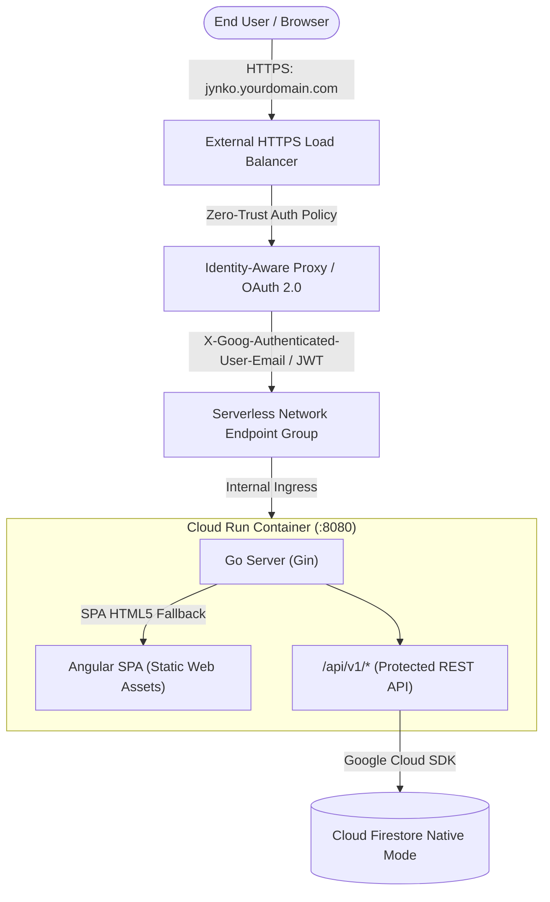

# Google Cloud Platform (GCP) Deployment & IAP Guide

This document is the official, complete step-by-step guide to deploying **Jynko** to Google Cloud Platform using **Google Cloud Run**, **Google Cloud Firestore**, **Cloud Build**, and **Google Cloud Identity-Aware Proxy (IAP)**.

---

## 1. Architecture Overview



### Why a Unified Container?
1. **Zero CORS Issues**: Both the Angular frontend and Go backend share the exact same host and port (`https://jynko.yourdomain.com`).
2. **Simplified IAP Configuration**: IAP protects the entire single domain. Once authenticated, browser requests to both the web UI and `/api/v1/*` endpoints carry the validated Google IAP identity headers.
3. **Atomic Deployments**: A single container release packages both frontend and backend versions in sync.

---

## 2. Prerequisites & Initial GCP Setup

### 2.1 Install & Initialize Google Cloud SDK
Ensure you have the Google Cloud CLI installed and logged in:
```bash
gcloud auth login
gcloud config set project YOUR_PROJECT_ID
```

Set common environment variables for your deployment shell:
```bash
export PROJECT_ID=$(gcloud config get-value project)
export REGION="europe-west3"
export SERVICE_NAME="jynko-plan-app"
export AR_REPO="jynko-plan"
export RUNNER_SA="jynko-plan-runner"
export BUILDER_SA="jynko-plan-build"
export DOMAIN="jynko.yourdomain.com"
```

### 2.2 Enable Required Google Cloud APIs
```bash
gcloud services enable \
  run.googleapis.com \
  cloudbuild.googleapis.com \
  artifactregistry.googleapis.com \
  firestore.googleapis.com \
  iap.googleapis.com \
  compute.googleapis.com
```

### 2.3 Create Cloud Firestore Database (Native Mode)
If your project does not already have a Cloud Firestore database:
```bash
gcloud firestore databases create --location=nam5 --type=firestore-native
```

### 2.4 Create Artifact Registry Repository
Create the Docker repository where Cloud Build will store container images:
```bash
gcloud artifacts repositories create $AR_REPO \
  --repository-format=docker \
  --location=$REGION \
  --description="Docker repository for Jynko releases"
```

---

## 3. Service Account & IAM Permissions

### 3.1 Runtime Service Account for Cloud Run
Create a dedicated least-privilege service account for the Jynko container:
```bash
gcloud iam service-accounts create $RUNNER_SA \
  --description="Runtime service account for Jynko Cloud Run service" \
  --display-name="Jynko Plan Runner"

# Grant permission to read and write to Firestore
gcloud projects add-iam-policy-binding $PROJECT_ID \
  --member="serviceAccount:${RUNNER_SA}@${PROJECT_ID}.iam.gserviceaccount.com" \
  --role="roles/datastore.user"
```

### 3.2 Cloud Build Service Account Permissions
Grant Cloud Build permission to deploy to Cloud Run and act as the runtime service account:
```bash
PROJECT_NUM=$(gcloud projects describe $PROJECT_ID --format='value(projectNumber)')


gcloud iam service-accounts create $BUILDER_SA \
  --description="Runtime service account for Jynko Cloud Run service" \
  --display-name="Jynko Plan Builder"

# Grant permission to read and write to Firestore
gcloud projects add-iam-policy-binding $PROJECT_ID \
  --member="serviceAccount:${BUILDER_SA}@${PROJECT_ID}.iam.gserviceaccount.com" \
  --role="roles/run.admin"
  
gcloud projects add-iam-policy-binding $PROJECT_ID \
  --member="serviceAccount:${BUILDER_SA}@${PROJECT_ID}.iam.gserviceaccount.com" \
  --role="roles/logging.logWriter"

gcloud projects add-iam-policy-binding $PROJECT_ID \
  --member="serviceAccount:${BUILDER_SA}@${PROJECT_ID}.iam.gserviceaccount.com" \
  --role="roles/source.reader"

gcloud projects add-iam-policy-binding $PROJECT_ID \
  --member="serviceAccount:${BUILDER_SA}@${PROJECT_ID}.iam.gserviceaccount.com" \
  --role="roles/artifactregistry.writer"

# Allow Cloud Build to assign the runtime service account to Cloud Run
gcloud iam service-accounts add-iam-policy-binding \
  "${RUNNER_SA}@${PROJECT_ID}.iam.gserviceaccount.com" \
  --member="serviceAccount:${BUILDER_SA}@${PROJECT_ID}.iam.gserviceaccount.com" \
  --role="roles/iam.serviceAccountUser"

```

---

## 4. Manual Deployment via Cloud Build CLI

To test the deployment manually from your local terminal:
```bash
gcloud builds submit --config=cloudbuild.yaml \
  --substitutions=_REGION=$REGION,_AR_LOCATION=$REGION,_AR_REPOSITORY=$AR_REPO,_SERVICE_NAME=$SERVICE_NAME,_SERVICE_ACCOUNT=$RUNNER_SA
```

---

## 5. Setting Up Continuous Deployment via Cloud Build Trigger

Automate deployments whenever commits are pushed to your Git repository (GitHub / GitLab / Cloud Source Repositories).

### 5.1 Connect your GitHub Repository
1. In the Google Cloud Console, navigate to **Cloud Build > Repositories (2nd gen)**.
2. Select your region (e.g., `us-central1`) and click **Create Host Connection** > **GitHub**.
3. Authenticate with GitHub and link your `gabihodoroaga/jynko` repository.

### 5.2 Create the Build Trigger via `gcloud`
Run the following command to create an automated build trigger on the `main` branch:
```bash
gcloud builds triggers create github \
  --name="jynko-plan-main" \
  --repo-name="jynko-plan" \
  --repo-owner="gabihodoroaga" \
  --branch-pattern="^main$" \
  --build-config="cloudbuild.yaml" \
  --region=$REGION \
  --substitutions=_REGION=$REGION,_AR_LOCATION=$REGION,_AR_REPOSITORY=$AR_REPO,_SERVICE_NAME=$SERVICE_NAME,_SERVICE_ACCOUNT=$RUNNER_SA
```

*(Alternatively, configure this in the Google Cloud Console under **Cloud Build > Triggers > Create Trigger**, selecting Repository Event: **Push to a branch**, Branch: `^main$`, and Configuration: **Cloud Build configuration file (`cloudbuild.yaml`)**).*

---

## 6. Configuring Google Cloud Identity-Aware Proxy (IAP)

Google Cloud Run cannot attach IAP directly to its default `*.run.app` URL without an **External HTTP(S) Load Balancer** fronted by a **Serverless Network Endpoint Group (NEG)**.

### 6.1 Configure OAuth Consent Screen & OAuth Client
1. In the Google Cloud Console, navigate to **APIs & Services > OAuth consent screen**.
2. Select **User Type**:
   - **Internal**: Recommended for Google Workspace organizations (all employees with `@company.com` can sign in).
   - **External**: For testing with personal Gmail accounts (requires adding test users).
3. Fill in:
   - **App name**: `Jynko`
   - **User support email**: your email
   - **Developer contact information**: your email
4. Click **Save and Continue**.
5. Navigate to **APIs & Services > Credentials** > **Create Credentials > OAuth client ID**:
   - **Application type**: `Web application`
   - **Name**: `Jynko IAP Client`
   - Click **Create**.
6. Save the generated **Client ID** and **Client Secret**:
   ```bash
   export CLIENT_ID="your-client-id.apps.googleusercontent.com"
   export CLIENT_SECRET="your-client-secret"
   ```

### 6.2 Create Serverless NEG and Backend Service
```bash
# 1. Create Serverless Network Endpoint Group (NEG) pointing to the Cloud Run service
gcloud compute network-endpoint-groups create jynko-neg \
  --region=$REGION \
  --network-endpoint-type=serverless \
  --cloud-run-service=$SERVICE_NAME

# 2. Create Global Backend Service with EXTERNAL_MANAGED scheme
gcloud compute backend-services create jynko-backend-service \
  --global \
  --load-balancing-scheme=EXTERNAL_MANAGED

# 3. Attach Serverless NEG to the Backend Service
gcloud compute backend-services add-backend jynko-backend-service \
  --global \
  --network-endpoint-group=jynko-neg \
  --network-endpoint-group-region=$REGION

# 4. Enable IAP on the Backend Service with the OAuth Client credentials
gcloud compute backend-services update jynko-backend-service \
  --global \
  --iap=enabled,oauth2-client-id=$CLIENT_ID,oauth2-client-secret=$CLIENT_SECRET
```

### 6.3 Set Up Global IP, Google-Managed SSL & Load Balancer
```bash
# 1. Reserve a Global Static External IP Address
gcloud compute addresses create jynko-ip --global

export STATIC_IP=$(gcloud compute addresses describe jynko-ip --global --format='value(address)')
echo "Configure your DNS A Record for ${DOMAIN} pointing to: ${STATIC_IP}"

# 2. Create Google-Managed SSL Certificate
gcloud compute ssl-certificates create jynko-ssl-cert \
  --domains=$DOMAIN

# 3. Create URL Map routing to the Backend Service
gcloud compute url-maps create jynko-url-map \
  --default-service=jynko-backend-service

# 4. Create Target HTTPS Proxy with the SSL Certificate
gcloud compute target-https-proxies create jynko-https-proxy \
  --url-map=jynko-url-map \
  --ssl-certificates=jynko-ssl-cert

# 5. Create Global Forwarding Rule
gcloud compute forwarding-rules create jynko-https-forwarding-rule \
  --load-balancing-scheme=EXTERNAL_MANAGED \
  --global \
  --target-https-proxy=jynko-https-proxy \
  --ports=443 \
  --address=jynko-ip
```

### 6.4 Lock Down Cloud Run Ingress
Prevent users or bots from bypassing IAP by accessing the direct `*.run.app` URL:
```bash
gcloud run services update $SERVICE_NAME \
  --region=$REGION \
  --ingress=internal-and-cloud-load-balancing
```

### 6.5 Grant Users Access via IAP Role
Grant access to specific users or your entire Google Workspace domain group:
```bash
# Example: Grant access to an entire Google Workspace group
gcloud iap web add-iam-policy-binding \
  --resource-type=backend-services \
  --service=jynko-backend-service \
  --member="group:team@yourcompany.com" \
  --role="roles/iap.httpsResourceAccessor"

# Or grant access to a single user
gcloud iap web add-iam-policy-binding \
  --resource-type=backend-services \
  --service=jynko-backend-service \
  --member="user:your-email@gmail.com" \
  --role="roles/iap.httpsResourceAccessor"
```

---

## 7. First-Time User Onboarding & Verification

1. **DNS Propagation**:
   - Ensure your DNS record for `jynko.yourdomain.com` has resolved to the static IP address.
   - Google-managed SSL provisioning takes 10–20 minutes on first domain association. Check status:
     ```bash
     gcloud compute ssl-certificates describe jynko-ssl-cert --format='value(managed.status)'
     ```
2. **Accessing the App**:
   - Open `https://jynko.yourdomain.com` in your browser.
   - You will see the Google Sign-in screen enforced by IAP.
3. **Automatic Project Creation & Seed**:
   - Upon logging in, Jynko's backend automatically extracts your identity from `X-Goog-Authenticated-User-Email`.
   - The initial project `proj-jynko-core` ("hodo") will be seeded in Firestore with your user assigned as `ADMIN`.
   - You can click the `+` button in the left sidebar to create new projects and manage your team.
4. **Team Collaboration**:
   - Invite coworkers by entering their emails in **Project Settings > Members**.
   - Make sure their email or Google group is also granted the `roles/iap.httpsResourceAccessor` role in GCP IAM.
